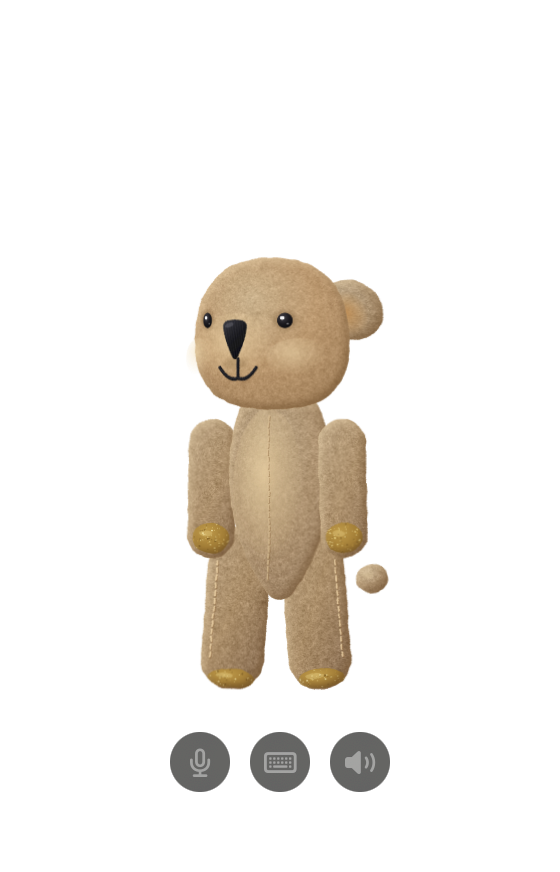

# PokkaTomo（波卡朋友）

一位住在你 Mac 裡的原創可愛夥伴。可以文字與語音聊天、有自己的個性、會記得你說過的事，還可以養好幾隻各自獨立的夥伴。
全部在你的電腦上運行：沒有帳號、沒有伺服器、不需付費。

An original character companion that lives on your Mac. Chat by text or voice, and it remembers you. Everything runs on-device — no account, no server, free.

  
  

## 下載
到右邊的 **Releases** 下載最新的 `PokkaTomo-mac-*.zip`（第一個版本準備中）。
第一次打開需要多一個步驟，請看 [HOW-TO-OPEN.md](HOW-TO-OPEN.md)。

## 需求
- Apple 晶片的 Mac（M1 以上），macOS 27
- 已開啟 Apple Intelligence（對話使用裝置端的 Apple 模型）
- 語言：繁體中文、日本語

## 這是搶先體驗版
目前是早期版本，可能有 bug。歡迎在 Issues 回報。

## 授權
- 程式：[PolyForm Noncommercial 1.0.0](LICENSE)，禁止商業使用。原始碼不公開。
- 角色美術、名稱與台詞：保留所有權利，見 [ASSETS-LICENSE.md](ASSETS-LICENSE.md)。

作者：`timshih0523-work`
